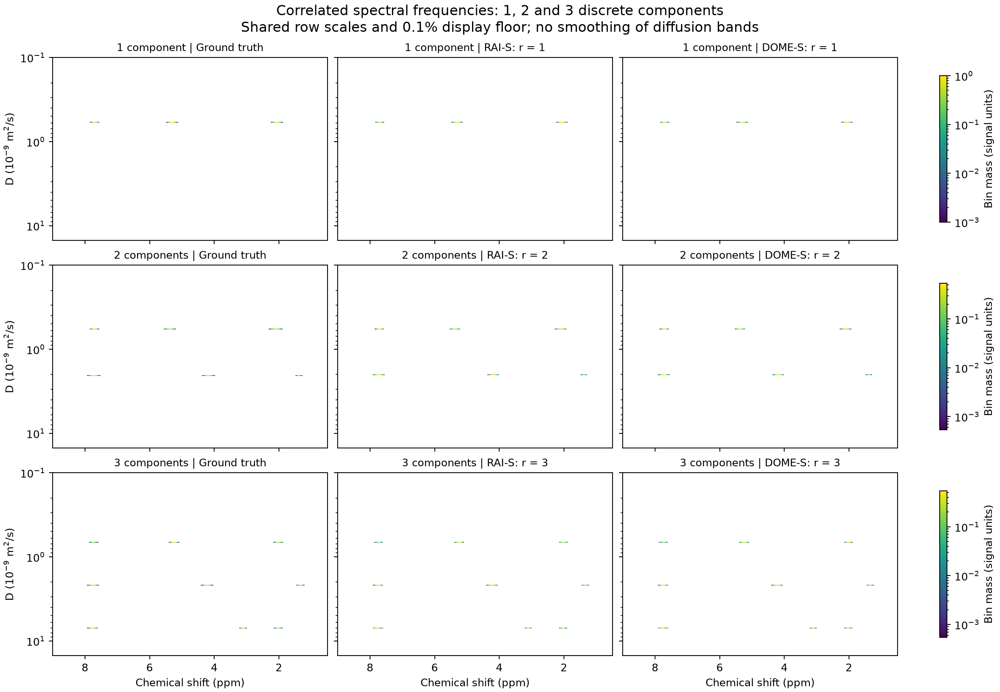

# TRAIn-DOSY: inversión conjunta positiva de Laplace
[English](README.md) · [API](docs/API_ES.md) · [Matemática](docs/METHODS_ES.md) · [Procedencia](docs/PROVENANCE.md) · [Artículo](paper/revision_complete_20261017/Manuscript_Revised_CLEAN.pdf)

**Software 0.2.1 — diagnósticos signed-v2.2.** `TRAIn-MF` conserva el signo y NNLS de MATLAB; ahora compara con un modelo sin señal, comprueba el ruido suministrado de forma independiente y avisa de los bordes de la rejilla de difusión. Informa por separado de convergencia numérica y rango predictivo. `MF-AUTO` y el benchmark original siguen congelados; el suplemento fechado de validación se presenta por separado. [Formulación, migración y pruebas reproducibles](docs/TRAIN_MF_SIGNED_ES.md).

Software de investigación de **Francisco M. Arrabal-Campos** para reconstrucción DOSY conjunta a partir de las regiones con señal del espectro completo. TRAIn-MF extiende el **TRAIn original de Xu y Zhang**. Arrabal-Campos lo desarrolló mediante sucesivas revisiones, incluidas V2, la V3 depurada previa al artículo y V3.1. El código V3.1 conservado y la implementación actual son versiones del mismo método. Véase la [evolución documentada](docs/TRAIN_MF_HISTORY.md).

Versión archivada del manuscrito: [manuscript-v6](https://github.com/fmarrabal/train-dosy/releases/tag/manuscript-v6), 38 páginas y 48 referencias. Indica el uso de Codex como ayuda para programar el repositorio y de Trinka para mejorar la claridad y el estilo del texto, sin detalles de modelos ni versiones. Conserva la autoría, financiación y auditoría matemática incorporadas en v5. Conserva el software numérico v0.1.0 y sus resultados. Véase la [auditoría del manuscrito](paper/AUDITORIA_MANUSCRITO_ES.md).

## Validación añadida el 17 de octubre de 2026

El [manuscrito revisado de 57 páginas y sus fuentes editables](paper/revision_complete_20261017/MANUSCRIPT.md) acompaña esta validación. Se conservan la versión numérica del software y el manuscrito histórico.

El [suplemento de validación](docs/VALIDATION_20261017_ES.md) incorpora protocolos, copias del código, redes entrenadas y resúmenes de resultados. Incluye 300 matrices de ruido, 96 problemas con componentes débiles, un estudio factorial pareado, un estudio de convergencia de TRAIn-MF, 120 problemas neuronales nuevos y comparaciones con implementaciones atribuidas de métodos de referencia. Los resúmenes experimentales abarcan cuatro series de resinas industriales y un ejemplo público de DOSY Toolbox.

Los resultados delimitan el alcance del método. Solo 14 de los 36 ajustes seleccionados de TRAIn-MF cumplieron el umbral KKT dentro del presupuesto común. RAI-S y DOME-S coincidieron con frecuencia y omitieron muchos componentes débiles. Cinco semillas de entrenamiento no demostraron una ventaja predictiva de la red sobre la política clásica. SCORE con amplitudes de signo libre predijo mejor el experimento público que los métodos globales positivos. Estos resultados no determinan el número de sustancias ni demuestran superioridad general.

La API sigue en la versión 0.2.1. El estudio de convergencia regularizado tiene una entrada con monitorización propia y está separado del backend signed-v2.2. Se conservan los resultados históricos. Esta actualización pública no incluye medidas industriales ni documentos privados de laboratorio; el ejemplo público se puede reconstruir mediante su URL, hash y scripts de procesado.

## ¿Por qué TRAIn-MF?
**MF significa multifrecuencia**, de acuerdo con la cabecera original de `TRAIn_DOSY_MFV31`. Matemáticamente se implementa mediante factorización matricial no negativa, `Y ≈ K S A`: las columnas de `S` son perfiles de difusión compartidos y las filas de `A` describen su intensidad en las distintas frecuencias. Sigue siendo multifrecuencia si el rango seleccionado es uno. Un perfil puede ser ancho o multimodal; el rango no equivale al número de sustancias.

**TRAIn-MF: extensión multifrecuencia de TRAIn mediante factorización matricial no negativa** es el nombre del algoritmo. V2, la V3 depurada previa al artículo, V3.1 y la implementación actual con restricciones pertenecen al mismo método. La implementación actual mejora su optimización y sustituye la iteración TRAIn interna por las actualizaciones con restricciones aquí documentadas. Se conservan los nombres de las funciones, los bytes del original, los núcleos numéricos y los resultados guardados. Consulta la [bibliografía ampliada](docs/BIBLIOGRAPHY_ES.md).

## Implementaciones incluidas
| Lenguaje | Contenido | Función |
|---|---|---|
| MATLAB | TRAIn-MF: código V3.1 conservado, DOSY_MF_Auto e implementación actual con restricciones | Perfiles distribucionales/polímeros, ≥256 bins, NNLS de MATLAB instalado |
| Python | RAI-S/DOME-S congelados, validación, CLI, API REST, benchmark y figuras | Tasas discretas compartidas y selección automática de soporte y orden |
| C#/.NET 10 | SDK tipado y cliente de consola | Usa la misma API; no es un tercer solver numérico independiente |
| Backend TRAIn-MF de la API | Ejecuta MATLAB nativo si el operador lo configura | Mantiene el algoritmo y los requisitos de licencia de MATLAB |

El TRAIn-MF de referencia y el núcleo atómico conservan su código y sus hashes. La publicación añade interfaces y reproducibilidad. La API automática no elimina componentes por un porcentaje de altura ni recibe su número verdadero. El estudio controlado de convergencia fija expresamente el rango para evaluar la optimización.

## Instalación de Python
Python ≥3.11; probado con Python 3.13.13:
~~~sh
git clone https://github.com/fmarrabal/train-dosy.git
cd train-dosy
python -m venv .venv
~~~
Windows:
~~~powershell
.\.venv\Scripts\Activate.ps1
python -m pip install -e ".[api,test,plots]"
~~~
Linux/macOS:
~~~sh
source .venv/bin/activate
python -m pip install -e ".[api,test,plots]"
~~~
requirements-lock.txt registra las versiones usadas; instalarlo antes del paquete editable para reproducir ese entorno. No se promete identidad binaria entre sistemas.

## Ejemplo completo
~~~sh
train-dosy examples/three_components/input.json resultado.json --method RAI-S
train-dosy examples/three_components/input.json dome-resultado.json --method DOME-S
python scripts/make_examples.py
python scripts/plot_examples.py
~~~
Las dos primeras órdenes ajustan las observaciones. Las otras regeneran ejemplos fijos de 1, 2 y 3 componentes y sus mapas DOSY con ground truth. input.json solo contiene entradas permitidas; truth.json está separado y nunca lo lee fit(). Los resultados guardados y examples/summary.json registran diagnósticos y error sobre ocho gradientes externos.

Uso directo:
~~~python
import json
from train_dosy import fit
entrada = json.load(open("examples/two_components/input.json"))
salida = fit(entrada)
print(salida["selected_rank"], salida["D"], salida["success"])
~~~

## Preparar datos reales
Y debe ser real y estar faseada: filas de adquisición por columnas de desplazamiento químico. Mantener el signo del ruido. b se expresa en s/m², D en m²/s, y bD es adimensional. No sustituir b por G² ni estimar unidades a ojo: el cálculo depende de la secuencia. La corrección de fase/base y la conversión física son previas. sigma debe ser positiva y estar en las unidades de Y; se supone ruido gaussiano homogéneo conocido.

Se seleccionan regiones con señal sobre el espectro completo y se ajustan conjuntamente sus frecuencias. La máscara excluye disolvente y línea base; esas frecuencias quedan sin estimar. El descubrimiento automático excluye filas de validación interna. Un ajuste independiente a un punto no equivale a recuperar componentes correlacionados entre frecuencias. [Contrato y límites](docs/API_ES.md).

En RAI-S y DOME-S, la malla de al menos 256 bins conserva masa para dibujar; las tasas se optimizan de forma continua. Más bins de dibujo no mejoran la resolución física. En TRAIn-MF las masas de esa malla sí son las incógnitas. Para representar densidad hay que dividir por el ancho del bin.

## MATLAB
Requiere MATLAB y Optimization Toolbox; probado con R2026a:
~~~matlab
addpath('matlab');
r = example_mf();
imagesc(r.ppm, log10(r.D), r.X);
set(gca,'XDir','reverse'); xlabel('ppm'); ylabel('log_{10} D (m^2/s)');
~~~
Uso directo:
~~~matlab
addpath('matlab/reference');
D = logspace(-10, log10(15e-9), 256)';
% Y solo contiene frecuencias seleccionadas; b y sigma tienen unidades físicas.
% La máscara no debe usar validación ni prueba externa.
[X,D,info] = DOSY_MF_Auto(Y,b,D,sigma,innerRows,validationRows,struct());
~~~
innerRows y validationRows son vectores lógicos disjuntos; el reajuste final usa su unión. Revisar info.status y, si existe, info.fit.kkt. Un resultado no resuelto no identifica especies.

matlab/legacy/TRAIn_DOSY_MFV31.m conserva la interfaz histórica de V3.1. D_params, reescalado opcional de b, suavizado y umbrales difieren de la referencia posterior. Se publica como antecedente, no como el selector automático validado en este artículo.

## API REST y C#
~~~sh
python -m uvicorn train_dosy.api:app --host 127.0.0.1 --port 8765
dotnet build csharp/TrainDosy.Cli -c Release
dotnet run --project csharp/TrainDosy.Cli -c Release -- examples/three_components/input.json csharp-resultado.json
~~~
Swagger: http://127.0.0.1:8765/docs . [Endpoints, unidades, errores, límites y backend MATLAB](docs/API_ES.md). El cliente admite una tercera opción con la URL del servidor y Ctrl+C para cancelar. Devuelve código distinto de cero si falla HTTP y código 3 si el solver no resuelve el ajuste.

SDK:
~~~csharp
using var http = new HttpClient {
    BaseAddress = new Uri("http://127.0.0.1:8765/"),
    Timeout = TimeSpan.FromMinutes(11)
};
var resultado = await new TrainDosy.DosyClient(http).FitAsync(entrada, cancellationToken);
~~~
En MATLAB, request = jsondecode(fileread('examples/one_component/input.json')); result = dosy_api(request); llama al mismo servicio local.

## Reproducir benchmark y artículo
~~~sh
python -m pytest -q
python benchmarks/run_atomic.py --count 48 --output benchmark_run
python paper/scripts/prepare_evidence.py
~~~
Compilación en PowerShell:
~~~powershell
.\paper\build.ps1
~~~
En otros sistemas, ejecutar pdflatex tres veces sobre main.tex desde paper/, con MiKTeX/TeX Live y las dependencias de la plantilla. Se incluyen fuentes editables y avisos originales de MDPI.

El protocolo tiene 36 casos discretos con señal, seis nulos y seis controles anchos. La recuperación conjunta de orden y todas las tasas es: RAI 17/36; RAI-S 23/36; DOME 22/36; DOME-S 23/36. Si solo se cuenta acertar el orden, los valores son 17, 25, 26 y 25 de 36. La coincidencia de los métodos S no es una replicación independiente. Las distribuciones poliméricas anchas requieren otra representación.

La figura TRAIn-MF original del manuscrito conserva el resultado guardado. El paquete original no incluía los estudios experimentales y neuronales posteriores. El suplemento fechado los añade conservando los fallos numéricos y los límites de identificación; no se afirma superioridad universal ni óptimo global. [Alcance y límites](docs/METHODS_ES.md). El benchmark completo puede tardar; los tres ejemplos no lo sustituyen.

## Organización
- src/train_dosy: contrato, API, CLI y estimador Python congelado.
- matlab/reference: TRAIn-MF nativo, NNLS, simplex, refinamiento y selección automática.
- matlab/legacy: TRAIn_DOSY_MFV31 original.
- csharp: SDK reutilizable y CLI.
- examples: entradas, verdad separada, ajustes y figuras.
- benchmarks: generador, evaluación y métricas previas por problema.
- paper: LaTeX, PDF, entradas sintéticas mínimas, tablas y figuras.
- provenance y verification: hashes y pruebas locales.
- docs: documentación bilingüe y atribución.

## Citas, licencia y estado
[CITATION.cff](CITATION.cff) contiene la cita del software. Citar también [TRAIn original](https://doi.org/10.1021/ac402698h) al describir la procedencia. Se incorporan tus trabajos sobre [diffGA](https://doi.org/10.1039/c7sm01569k), [dART](https://doi.org/10.1021/acs.jpca.8b08584) y [Kaczmarz regularizado](https://doi.org/10.3390/math13132166), junto con los estudios de peso molecular y la corrección de 2016.

Software GPL-3.0-or-later; [NOTICE](NOTICE) conserva las atribuciones y las distinciones entre dependencias. MATLAB se licencia aparte. Es software de investigación: las comprobaciones computacionales no acreditan identidad química ni aceptación editorial. Las comprobaciones son locales. GitHub Actions permanece deshabilitado y no se instalan workflows.
