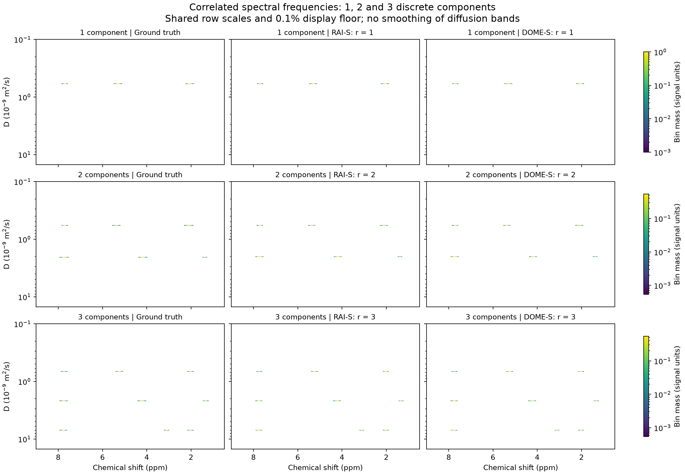

# TRAIn-DOSY: inversión conjunta positiva de Laplace
[English](README.md) · [Manuscrito](paper/Manuscript.pdf) · [Fuente editable](paper/manuscript/Manuscript.tex) · [API](docs/API_ES.md) · [Matemáticas](docs/METHODS_ES.md) · [Validación](docs/VALIDATION_ES.md)

TRAIn-DOSY reconstruye conjuntamente componentes de difusión en las regiones espectrales con señal. **TRAIn-MF** significa multifrecuencia: ajusta perfiles de difusión no negativos compartidos y sus amplitudes espectrales mediante `Y ≈ K S A`. **RAI-S** y **DOME-S** ajustan tasas de difusión atómicas compartidas con selección automática del soporte espectral y del orden. Son representaciones diferentes; el número de factores no equivale al número de sustancias.

TRAIn-MF es la extensión multifrecuencia de Francisco M. Arrabal-Campos del algoritmo TRAIn original de Xu y Zhang. Las [atribuciones](docs/PROVENANCE.md) identifican los métodos originales y las implementaciones de terceros.

Este árbol contiene el manuscrito final, los métodos numéricos, los clientes, los ejemplos y los registros de validación que sustentan el artículo. Los manuscritos anteriores y las iteraciones de desarrollo siguen recuperables en el historial de Git. Los archivos vigentes tienen nombres sin sufijos de borrador o revisión.



## Implementaciones

| Entrada | Lenguaje | Función |
|---|---|---|
| `RAI-S`, `DOME-S` | Python | Tasas atómicas compartidas y selección automática de soporte/orden |
| `TRAIn-MF` | MATLAB, accesible desde la API | Observaciones con signo, perfiles por región de confianza y amplitudes NNLS |
| `MF-AUTO` | MATLAB, accesible desde la API | Referencia regularizada con restricciones utilizada en el artículo |
| API REST y CLI | Python | Contrato común con unidades físicas |
| SDK y CLI | C#/.NET 10 | Cliente tipado de la misma API de referencia |

El software utiliza la versión 0.2.1. El protocolo de respuesta de `TRAIn-MF` sigue siendo `signed-v2.2`: es un identificador del contrato de la API. La [guía de TRAIn-MF](docs/TRAIN_MF_ES.md) describe su objetivo, escalado y diagnóstico. La referencia regularizada del manuscrito tiene otro objetivo y se selecciona expresamente como `MF-AUTO`.

## Instalación de Python
Python ≥3.11; probado con Python 3.13.13:
~~~sh
git clone https://github.com/fmarrabal/train-dosy.git
cd train-dosy
python -m venv .venv
~~~
Windows:
~~~powershell
.\.venv\Scripts\Activate.ps1
python -m pip install -e ".[api,test,plots]"
~~~
Linux/macOS:
~~~sh
source .venv/bin/activate
python -m pip install -e ".[api,test,plots]"
~~~
requirements-lock.txt registra las versiones usadas; instalarlo antes del paquete editable para reproducir ese entorno. No se promete identidad binaria entre sistemas.

## Ejemplo completo
~~~sh
train-dosy examples/three_components/input.json resultado.json --method RAI-S
train-dosy examples/three_components/input.json dome-resultado.json --method DOME-S
python scripts/make_examples.py
python scripts/plot_examples.py
~~~
Las dos primeras órdenes ajustan las observaciones. Las otras regeneran ejemplos fijos de 1, 2 y 3 componentes y sus mapas DOSY con ground truth. input.json solo contiene entradas permitidas; truth.json está separado y nunca lo lee fit(). Los resultados guardados y examples/summary.json registran diagnósticos y error sobre ocho gradientes externos.

Uso directo:
~~~python
import json
from train_dosy import fit
entrada = json.load(open("examples/two_components/input.json"))
salida = fit(entrada)
print(salida["selected_rank"], salida["D"], salida["success"])
~~~

## Preparar datos reales
Y debe ser real y estar faseada: filas de adquisición por columnas de desplazamiento químico. Mantener el signo del ruido. b se expresa en s/m², D en m²/s, y bD es adimensional. No sustituir b por G² ni estimar unidades a ojo: el cálculo depende de la secuencia. La corrección de fase/base y la conversión física son previas. sigma debe ser positiva y estar en las unidades de Y; se supone ruido gaussiano homogéneo conocido.

Se seleccionan regiones con señal sobre el espectro completo y se ajustan conjuntamente sus frecuencias. La máscara excluye disolvente y línea base; esas frecuencias quedan sin estimar. El descubrimiento automático excluye filas de validación interna. Un ajuste independiente a un punto no equivale a recuperar componentes correlacionados entre frecuencias. [Contrato y límites](docs/API_ES.md).

En RAI-S y DOME-S, la malla de al menos 256 bins conserva masa para dibujar; las tasas se optimizan de forma continua. Más bins de dibujo no mejoran la resolución física. En TRAIn-MF las masas de esa malla sí son las incógnitas. Para representar densidad hay que dividir por el ancho del bin.

## MATLAB
Requiere MATLAB y Optimization Toolbox; probado con R2026a:
~~~matlab
addpath('matlab');
r = example_mf();
imagesc(r.ppm, log10(r.D), r.X);
set(gca,'XDir','reverse'); xlabel('ppm'); ylabel('log_{10} D (m^2/s)');
~~~
Uso directo:
~~~matlab
addpath('matlab/reference');
D = logspace(-10, log10(15e-9), 256)';
% Y solo contiene frecuencias seleccionadas; b y sigma tienen unidades físicas.
% La máscara no debe usar validación ni prueba externa.
[X,D,info] = DOSY_MF_Auto(Y,b,D,sigma,innerRows,validationRows,struct());
~~~
innerRows y validationRows son vectores lógicos disjuntos; el reajuste final usa su unión. Revisar info.status y, si existe, info.fit.kkt. Un resultado no resuelto no identifica especies.

## API REST y C#
~~~sh
python -m uvicorn train_dosy.api:app --host 127.0.0.1 --port 8765
dotnet build csharp/TrainDosy.Cli -c Release
dotnet run --project csharp/TrainDosy.Cli -c Release -- examples/three_components/input.json csharp-resultado.json
~~~
Swagger: http://127.0.0.1:8765/docs . [Endpoints, unidades, errores, límites y backend MATLAB](docs/API_ES.md). El cliente admite una tercera opción con la URL del servidor y Ctrl+C para cancelar. Devuelve código distinto de cero si falla HTTP y código 3 si el solver no resuelve el ajuste.

SDK:
~~~csharp
using var http = new HttpClient {
    BaseAddress = new Uri("http://127.0.0.1:8765/"),
    Timeout = TimeSpan.FromMinutes(11)
};
var resultado = await new TrainDosy.DosyClient(http).FitAsync(entrada, cancellationToken);
~~~
En MATLAB, request = jsondecode(fileread('examples/one_component/input.json')); result = dosy_api(request); llama al mismo servicio local.

## Reproducir benchmark y artículo
~~~sh
python -m pytest -q
python benchmarks/run_atomic.py --count 48 --output benchmark_run
python validation/primary/replay_figures.py
~~~
Compilación en PowerShell:
~~~powershell
.\paper\build.ps1
~~~
En otros sistemas, ejecutar pdflatex tres veces sobre Manuscript.tex desde paper/manuscript/, con MiKTeX/TeX Live y las dependencias de la plantilla. Se incluyen fuentes editables y avisos originales de MDPI.

El protocolo tiene 36 casos discretos con señal, seis nulos y seis controles anchos. La recuperación conjunta de orden y todas las tasas es: RAI 17/36; RAI-S 23/36; DOME 22/36; DOME-S 23/36. Si solo se cuenta acertar el orden, los valores son 17, 25, 26 y 25 de 36. La coincidencia de los métodos S no es una replicación independiente. Las distribuciones poliméricas anchas requieren otra representación.

Los registros de validación conservan los fallos numéricos, los límites para componentes débiles y los casos en que las referencias clásicas predijeron mejor. Consulta la [guía de validación](docs/VALIDATION_ES.md). El benchmark completo puede tardar; los tres ejemplos son demostraciones breves.

## Archivos finales y validación

- `paper/Manuscript.pdf`: manuscrito final sin notas de desarrollo ni listados de sumas de comprobación.
- `paper/manuscript/Manuscript.tex`: fuente editable, figuras y plantilla necesarias.
- `validation/`: protocolos, resultados conservados, redes y scripts de cada estudio.
- `examples/`: observaciones y ground truth separados para uno, dos y tres componentes.
- `src/`, `matlab/`, `csharp/`: implementación numérica y clientes de la API.
- `docs/`: API, formulación matemática, interpretación y validación en español e inglés.

Comprobaciones de solo lectura:
```sh
python validation/check_compact_summaries.py
python scripts/verify.py
```

En el estudio controlado de convergencia, 14/36 ajustes seleccionados de TRAIn-MF alcanzaron estacionariedad y 22 quedaron sin resolver. Se recuperó la tasa débil en 45/96 problemas RAI-S y 44/96 DOME-S. Cinco semillas neuronales no demostraron una mejora de precisión predictiva. El artículo conserva estas limitaciones y la mejor predicción de SCORE con signo en el ejemplo público.

Las observaciones industriales procesadas y las amplitudes ajustadas por espécimen acompañan al suplemento de la revista. La correspondencia editorial permanece privada. Los datos públicos de referencia se obtienen con su descargador atribuido. Véanse [validación](docs/VALIDATION_ES.md) y [avisos de terceros](THIRD_PARTY_NOTICES.md).

## Cita y licencia

Usa [CITATION.cff](CITATION.cff) y cita [TRAIn original](https://doi.org/10.1021/ac402698h). Otros trabajos relacionados: [diffGA](https://doi.org/10.1039/c7sm01569k), [dART](https://doi.org/10.1021/acs.jpca.8b08584) y [Kaczmarz regularizado](https://doi.org/10.3390/math13132166).

El software es GPL-3.0-or-later, con los [avisos](NOTICE) y licencias de sus dependencias. MATLAB se licencia aparte. Codex ayudó en la programación del repositorio y Trinka en la mejora del texto; los autores asumen la responsabilidad del trabajo. La validación es local y GitHub Actions sigue deshabilitado.
